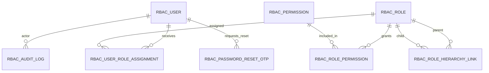

# R&M Trucking RBAC Architecture

## Scope

R&M Trucking is the only organization using this application. This design has no tenant model and no employee region, station, or terminal restrictions. R&M employees access company records according to role permissions. Customer users are read-only and can view only their own receipts and shipments.

The existing `Customers` table and current `maintenance/User.ts` login flow are not changed. `RbacUser` is a new, separate authorization model. It is not connected to production login until its DB2 table, repositories, endpoints, tests, and an explicit cutover are implemented.

## Relationships



```text
RbacUser -> RbacUserRoleAssignment -> RbacRole
RbacRole -> RbacRolePermission -> RbacPermission

Customer user -> customerId filter -> own receipts and shipments only
Employee user -> role permissions -> R&M company records
```

`RbacRolePermission` is the many-to-many link between roles and permissions. One role can have many permissions, and a permission can be reused by many roles. `RbacUserRoleAssignment` lets one user have multiple roles. Do not put a single `roleId` on `RbacUser`.

## Authorization Entities

| Entity/table             | Purpose                                                                                                               | Key rules                                                                                                                        |
| ------------------------ | --------------------------------------------------------------------------------------------------------------------- | -------------------------------------------------------------------------------------------------------------------------------- |
| `RbacUser`               | New authorization user record: login/name/email, password hash, active status, `userType`, and nullable `customerId`. | `userType` is `EMPLOYEE` or `CUSTOMER`. Customer users require the existing customer ID. Never return `passwordHash` to clients. |
| `RbacPasswordResetOtp`   | Short-lived password-reset challenge linked to one `RbacUser`.                                                       | Store only an HMAC digest of the OTP; expire, limit attempts, and allow one successful use.                                      |
| `RbacRole`               | Named role with `roleKind`, status, and row version.                                                                  | `roleKind` is `EMPLOYEE` or `CUSTOMER`; assignment requires `userType === roleKind`.                                             |
| `RbacPermission`         | One stable action key, such as `warehouse.receipt.view`.                                                              | Unique `permissionKey`; status controls whether it can be granted. Changing an action's meaning requires a new key.              |
| `RbacUserRoleAssignment` | Links one user to one role.                                                                                           | Composite key `(userId, roleId)`; supports multiple roles per user and optional validity dates.                                  |
| `RbacRolePermission`     | Links one role to one permission.                                                                                     | Composite key `(roleId, permissionId)`; one row per grant.                                                                       |
| `RbacRoleHierarchyLink`  | Links a parent role to a child role for role administration/delegation.                                               | No cycles; parent and child must have the same `roleKind`. A child does not automatically inherit every parent permission.       |
| `RbacAuditLog`           | Records role, permission, and assignment changes and security outcomes.                                               | Append-only; record actor, target, action, result, timestamp, and reason.                                                        |

The `customerId` column in `RbacUser` references the existing customer primary key. Match its DB2 data type before adding a foreign key. Do not alter or duplicate the existing customer record. Multiple customer users may reference the same customer ID.

## Role and Permission Rules

- **Employee roles:** grant the employee actions needed for the job. For example, a Warehouse Operator role might have `warehouse.receipt.view`, `warehouse.receipt.create`, and `freight.scan`. Employee access is across R&M records; location is not an authorization dimension.
- **Customer roles:** grant only `warehouse.receipt.view` and `shipment.view`. Do not grant customer users create, edit, delete, approve, export, print, email, upload, download, billing, EDI, administration, or other permissions under the current requirement.
- Store one `RbacRolePermission` row per role/permission pair. A role with three permissions has three rows.
- Store one `RbacUserRoleAssignment` row per user/role pair. Effective permissions are the union of active role grants, subject to the customer-only allowlist and mandatory customer filter.
- The role hierarchy controls delegation and role management; it does not automatically give a child every parent permission. Reject permissions outside the delegator's delegation ceiling, hierarchy cycles, and cross-kind parent/child links.

## Request-Time Flow

1. Authenticate a `RbacUser` and reject the account if `activeStatus` is not active.
2. Load active `RbacUserRoleAssignment` rows and their roles.
3. Confirm each assigned role's `roleKind` matches the user's `userType`; otherwise deny.
4. Join role assignments to `RbacRolePermission` and `RbacPermission` to build the effective permission set.
5. Check the exact requested action. `shipment.view` does not grant shipment edit, export, or approve.
6. For an employee, execute the permission-checked query across R&M records without a location predicate.
7. For a customer user, allow only `warehouse.receipt.view` or `shipment.view`, then add the authenticated user's `customerId` to the query.
8. Audit role/permission changes and security-sensitive outcomes. Missing or invalid user, role, permission, or customer data must deny access.

Example customer receipt query:

```sql
SELECT ...
FROM WarehouseReceipt
WHERE receipt_id = ? AND customer_id = ?
```

The final parameter comes from the authenticated `RbacUser`, never the request body or query string. Apply the same rule to receipt/shipment lists, detail endpoints, attachments, and every customer-visible response. Customer APIs are read-only; hiding buttons in the UI is not authorization.

## Permission Data Example

The permission catalog stores each action once:

| permissionId | permissionKey              |
| -----------: | -------------------------- |
|            1 | `warehouse.receipt.view`   |
|            2 | `warehouse.receipt.create` |
|            3 | `shipment.view`            |

Then `RbacRolePermission` rows connect permissions to roles. If employee role 10 has receipt view and create, it has `(10, 1)` and `(10, 2)`. A customer-view role can have `(customerRoleId, 1)` and `(customerRoleId, 3)` only. `RbacUserRoleAssignment` then connects each user to one or more roles.

## Administration Endpoints

These are proposed endpoints for the new authorization flow. They do not replace existing routes until a deliberate cutover.

| Route                                        | Rule                                                                                                         |
| -------------------------------------------- | ------------------------------------------------------------------------------------------------------------ |
| `GET /rbac/permissions`                      | List active permission keys. Permission catalog changes are controlled administrative/deployment operations. |
| `GET /rbac/roles`                            | List roles, optionally filtered by `roleKind`.                                                               |
| `POST /rbac/roles`                           | Create an employee or customer role.                                                                         |
| `PUT /rbac/roles/{roleId}/permissions`       | Add/remove grants after role-kind and delegation checks; enforce the customer permission allowlist.          |
| `POST /rbac/users/{userId}/roles`            | Assign a role only when user type and role kind match.                                                       |
| `DELETE /rbac/users/{userId}/roles/{roleId}` | Revoke the assignment and write an audit event.                                                              |
| `GET /customer/receipts`                     | Require `warehouse.receipt.view` and filter by authenticated `customerId`.                                   |
| `GET /customer/shipments`                    | Require `shipment.view` and filter by authenticated `customerId`.                                            |

## Forgot Password With Email OTP

Password recovery is an authentication flow, not an RBAC permission. It does not change a user's role or customer access. A user proves control of the email already registered on their `RbacUser` account, then sets a new password.

### Reset OTP Record

Store one row in `RbacPasswordResetOtp` for each reset challenge:

| Column | Purpose |
|---|---|
| `resetOtpId` | Primary key for the challenge. |
| `userId` | Foreign key to `RbacUser`. |
| `otpHash` | HMAC-SHA-256 digest of the code; never store the raw OTP. |
| `createdAt`, `expiresAt` | Issue time and expiration time. |
| `attemptCount` | Failed verification attempts. Lock after the configured limit. |
| `status` | `PENDING`, `CONSUMED`, `INVALIDATED`, or `LOCKED`. |
| `consumedAt` | Set once the password reset succeeds. |

Index pending challenges by `(userId,status,expiresAt)`. When a new code is issued, invalidate previous pending codes for that user. A reasonable initial policy is a six-digit code valid for 10 minutes, at most five verification attempts, and a small configurable send limit per account and source IP. Tune those limits to the email delivery and support requirements.

### Endpoints and flow

1. `POST /auth/password-reset/request` accepts an email or login name. Look up an active account and send the code to its registered email. Always return the same generic accepted response whether the account exists or not; do not reveal account existence or email status.
2. Generate the code with a cryptographically secure random-number generator. Calculate an HMAC using a server-side secret and a challenge-specific value, then store only the digest. Never log the code or include it in telemetry.
3. Email the code with a clear expiration time. Rate-limit requests by account and IP, and invalidate older pending codes when issuing a replacement.
4. `POST /auth/password-reset/complete` accepts the login/email, OTP, and new password. Find the pending, unexpired challenge, compare digests in constant time, and increment `attemptCount` on failure. Mark the challenge `LOCKED` when the attempt limit is reached.
5. On success, in one DB2 transaction, hash and update `RbacUser.passwordHash`, mark the OTP `CONSUMED`, and invalidate the user's other pending reset codes. Revoke active sessions/refresh tokens so the old password cannot continue through an existing session.
6. Return a generic failure for invalid, expired, used, or locked codes. Audit request, failure, lock, and success events without storing the OTP or password.

The reset completion operation must be atomic so two simultaneous submissions cannot reuse one OTP. Do not send a new password by email. Continue to require normal login after reset; the reset OTP does not itself become an access token.

## Security and Rollout

- Use parameterized DB2 queries. Build customer filters into the SQL query; never fetch all rows and filter in application memory.
- Use password hashes, not plaintext. Do not serialize `RbacUser` directly; create response DTOs without `passwordHash`.
- Audit role creation, permission grants/revokes, user-role assignments, failed authorization, and customer access denials.
- Use transactions and optimistic locking (`rowVersion`) for role and permission changes.
- Keep existing `User`, login, and API behavior unchanged while building this separate model.
- Add and review DB2 migrations, repositories, authorization middleware, and tests before switching any traffic to `RbacUser`.
- Test employee/customer role mismatch, customer 100 requesting customer 200 data, customer write attempts, missing customer ID, and permission revocation.

## Acceptance Criteria

- An employee can hold multiple employee roles, and each role can grant multiple permissions.
- A customer user can hold customer roles only, and those roles grant only receipt and shipment view.
- Customer receipt/shipment reads are always filtered by the authenticated user's existing `customerId`.
- Customer users cannot write or access another customer's data, including by changing request IDs.
- The existing login flow and existing `Customers` table remain unchanged until a separately reviewed cutover or migration.
